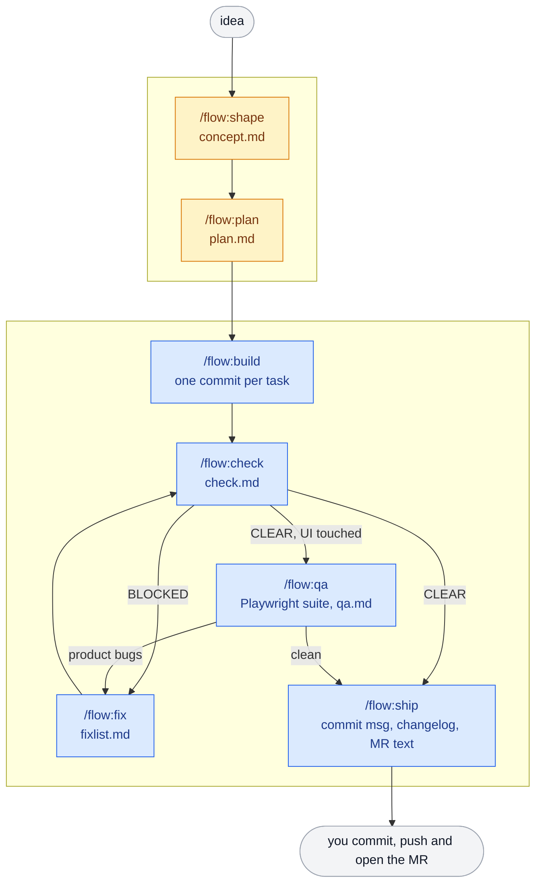

# flow

A test-driven development pipeline for Claude Code, opencode and Codex. Each phase
reads one artifact, does one job, writes one artifact, and stops. You clear the
context between phases, so every phase starts near-empty and nothing is lost.

    /flow:shape <idea>    ->  .work/<slug>/concept.md   interrogation + hostile domain critique
    /flow:plan  <slug>    ->  .work/<slug>/plan.md      test-first tasks, superpowers writing-plans format
    /flow:build <slug>    ->  commits                   one TDD subagent per task
    /flow:check <slug>    ->  .work/<slug>/check.md     E2E + security + future + complexity review
    /flow:qa    <slug>    ->  tests/e2e/<slug>.spec.ts  exhaustive Playwright suite, run for real
                              .work/<slug>/qa.md
    /flow:fix   <slug>    ->  commits                   applies the findings you accepted
    /flow:ship  <slug>    ->  commit msg + changelog + MR description (prepared, never executed)
    /flow:next  [slug]    ->  tells you where you are

In opencode the same commands are `/flow-shape`, `/flow-plan`, and so on.

Amber phases are interactive: you answer questions and approve. Blue phases
run on their own, one at a time by hand or all of them with
[`flowpipe run <slug>`](#running-it-unattended-flowpipe). Each box is one
command and one artifact in `.work/<slug>/`. Clear the context between boxes:
the artifact carries everything the next phase needs.

## Requirements

- Claude Code 2.1.275 or later, opencode, or Codex CLI.
- git. Every phase works on a feature branch and diffs against the integration
  branch it was cut from.
- Optional, used automatically when present:
  - [superpowers](https://github.com/obra/superpowers): `brainstorming`,
    `writing-plans` and `test-driven-development` skills. `writing-plans` is
    what gives `/flow:plan` its best output.
  - ponytail: `/ponytail-review` is folded into `/flow:check`.
  - compound-engineering: `ce-code-review` is folded into `/flow:check`.
  - a Playwright MCP server: used by `/flow:qa` as a debugger while triaging
    failures, never as the test runner.

## Install

### Claude Code

From GitHub:

    /plugin install flow --marketplace miloski93/agentic-flow

From a local clone:

    /plugin marketplace add /path/to/this/repo
    /plugin install flow@flow-local

Confirm: typing `/flow:` autocompletes eight commands, and `/agents` lists seven
`flow-*` agents.

### opencode

opencode reads plain files, so clone the repo and render them with
[flowpipe](flowpipe/README.md), which carries the renderer:

    pip install -e flowpipe
    flowpipe render opencode

This writes `flow-*.md` into `~/.config/opencode/commands` and
`~/.config/opencode/agents` (`$OPENCODE_ROOT` overrides the directory). Then add
the skills directory to `skills.paths` in `~/.config/opencode/opencode.json` so
the shared `flow-rules` skill loads:

    "skills": { "paths": ["/path/to/this/repo/flow/skills"] }

Restart opencode and type `/flow-` to confirm.

### Codex

Codex loads the plugin itself, commands and skill included, from the same
marketplace:

    codex plugin marketplace add /path/to/this/repo

and takes its subagents as TOML files, which the renderer writes into
`~/.codex/agents` (`$CODEX_HOME` overrides the directory):

    pip install -e flowpipe
    flowpipe render codex

`opencode` and `codex` above are bare platform names: a render with no models,
where every subagent inherits the session model. To choose models, render a
[model profile](#model-profiles) instead.

### Per project

The `.work/` artifacts are local scratch. In each repository you use flow in:

    echo '.work/' >> .git/info/exclude

## How to use it

Start with an idea, on any branch:

    /flow:shape let users export their invoices as CSV

flow asks where to branch from if you are on an integration branch, creates
`feat/<slug>`, questions you until nothing material is unclear, writes
`concept.md`, and has hostile critics attack it. You accept or reject each
finding. It then prints the next command and stops.

From there the loop is always the same: run `/clear`, then the command the
previous phase printed.

    /clear
    /flow:plan invoice-csv-export       # review the task table, approve it
    /clear
    /flow:build invoice-csv-export      # one commit per task, resumable
    /clear
    /flow:check invoice-csv-export      # verdict: CLEAR or BLOCKED
    /clear
    /flow:qa invoice-csv-export         # only when the diff touches UI
    /clear
    /flow:ship invoice-csv-export

Lost track? `/flow:next <slug>` reads the artifacts and tells you which command
comes next. `/flow:next` with no argument lists every feature in `.work/`.

### When check or qa finds something

Neither phase fixes anything. They report and ask which findings you want
addressed. Write the ones you accept into `.work/<slug>/fixlist.md` as
unchecked boxes, then:

    /clear
    /flow:fix <slug>
    /clear
    /flow:check <slug>

Findings you did not put on the list are treated as recorded trade-offs, not
work.

## Phases

**shape** interrogates the idea, writes a concept, then attacks it with one
generic critic plus one senior-engineer critic per domain it touches. Rejected
findings are recorded so the security review can see what was consciously
traded away.

**plan** delegates the plan format to the superpowers `writing-plans` skill -
real test code in every step, exact commands, Files and Interfaces blocks, no
placeholders - with three overrides: the plan is written to
`.work/<slug>/plan.md`, the spec is `concept.md`, and execution is
`/flow:build`. Every task also carries a `**Reuse:**` line naming the existing
code it extends, and must stay under 10 steps and 8,000 characters.

**build** dispatches one fresh TDD subagent per task, verifies each claim by
re-running the task's own commands, ticks the plan's checkboxes, and commits.
Re-running it resumes rather than redoing.

**check** runs the real stack end to end, then reviews the diff in parallel for
security, six-month cost, and over-engineering. The verdict is BLOCKED while
any High finding is unresolved.

**qa** enumerates an exhaustive scenario matrix, extends the project's existing
Playwright harness rather than building a parallel one, writes the specs, runs
them for real, and triages every failure as a product bug or a test defect. It
then proves the suite is worth having: each new spec is re-run against the
merge base in a throwaway worktree and must fail there. Finally it re-runs the
specs repeatedly, serially and in parallel, to catch flake. The suite is
committed and runs in CI from then on.

**fix** applies the items in `fixlist.md` one at a time, each with a failing
test first, one commit per item.

**ship** prepares a commit message, a changelog entry, and an MR description.
It never commits, pushes, or opens anything.

## Artifacts

Everything lives in `.work/<slug>/`:

| File          | Written by   | Read by                    |
|---------------|--------------|----------------------------|
| `concept.md`  | shape        | plan, check, qa, ship      |
| `plan.md`     | plan         | build, check, qa, fix      |
| `check.md`    | check        | fix, ship, next            |
| `qa.md`       | qa           | fix, ship, next            |
| `fixlist.md`  | you          | fix                        |

`check.md` and `qa.md` begin with YAML frontmatter (`verdict`, `high_findings`,
`e2e`, `ui_touched`, `product_bugs`, ...) so a script can drive the pipeline
without parsing prose.

## Agents

    flow-critic     hostile design reviewer, also plays domain expert
    flow-impl       single-task TDD implementer, reuse-first
    flow-e2e        real-stack end-to-end verifier
    flow-sec        15-point hostile security review
    flow-future     six-months-from-now cost review
    flow-simplify   over-engineering, duplication and missed-reuse review
    flow-qa         Playwright suite author, deterministic or it says so

## Model profiles

Out of the box every subagent runs on the model of the session that dispatched
it. A model profile changes that: it says which model each subagent uses on one
platform, so you can keep one profile for Claude Code, one for Codex, one for
opencode with an API-key provider, and switch between them.

The plugin files never name a model. They name a **tier**:

    fast        mechanical work that follows an existing pattern
    standard    ordinary work
    strong      new interfaces, cross-module changes, security-sensitive code

A profile maps the tiers to the models its platform offers. Profiles live in one
file outside the repository, `~/.config/flowpipe/models.yaml`
(`$FLOW_MODELS` overrides the path):

    agents:                      # which tier each subagent runs on
      flow-impl: standard
      flow-sec: strong
      flow-critic: strong

    profiles:
      claude:
        platform: claude         # claude | opencode | codex
        session: opus            # model of the phase session itself (optional)
        tiers: {fast: haiku, standard: sonnet, strong: opus}

      opencode-api:
        platform: opencode
        session: anthropic/claude-sonnet-5-5
        tiers:
          fast: anthropic/claude-haiku-5-5
          strong: anthropic/claude-opus-5-5

Start from [`flowpipe/models.yaml.example`](flowpipe/models.yaml.example). The
rules are few:

- A subagent missing from `agents`, or on a tier its profile does not define,
  gets no model and inherits the session model. A profile with one model
  therefore needs no `tiers` at all.
- A profile may carry its own `agents` map; it is merged over the shared one.
- Model ids are written the way the platform expects them: an alias or full id
  for Claude Code, `provider/model` for opencode, the model name for Codex.
  API keys and logins stay in each tool's own configuration.

### Applying a profile

    flowpipe render <profile>

writes the plugin's subagents, with the profile's models, where the platform
loads them from:

| Platform    | Written to | How it is loaded |
|-------------|------------|------------------|
| Claude Code | a complete plugin copy under flowpipe's state directory, `rendered/<profile>/` | `claude --plugin-dir <that dir>/flow`, which takes precedence over an installed flow for that session. To make it permanent, add `rendered/<profile>` as your marketplace instead of the repository. |
| opencode    | `~/.config/opencode/agents` and `commands` | automatically |
| Codex       | `~/.codex/agents/flow-*.toml` | automatically |

opencode and Codex each hold one rendered profile at a time: rendering another
one replaces it. `flowpipe run --profile <profile>` renders by itself before
every phase, so an unattended run never works from a stale render.

### Per-task routing

`/flow:plan` gives every task a tier and a reason, and shows both in the task
table you approve:

    **Model:** fast - one file, copies the existing exporter

`/flow:build` routes each task to the implementer pinned to that tier
(`flow-impl-fast`, `flow-impl-standard`, `flow-impl-strong`; every render
creates all three). A task that fails verification is retried once on the next
tier up. Edit a task's `**Model:**` line to overrule the planner; remove the
line and the task runs on plain `flow-impl`. A value that is not a tier stops
the build.

Because a plan carries tiers and not model names, a plan written on one
platform builds unchanged on another.

Without a rendered profile (a plain Claude Code marketplace install) the pinned
implementers do not exist; build then says so and uses `flow-impl`, on the
session model, for every task.

## Rules every phase obeys

The `flow-rules` skill is loaded at the start of each command:

- **Branch**: never shape or plan on main, master, dev, develop or staging.
- **Evidence**: no pass without pasted command output.
- **Tests**: test first; never weaken, skip, or edit a test to reach green.
- **Reuse**: search before writing, then declare `REUSING <path>` or
  `NEW <path>, searched <terms>`.
- **Simplicity**: no new dependency without asking, no abstraction for a use
  case that does not exist yet.
- **Scope**: touch only the files the task names.
- **Worktrees**: scratch worktrees live in the temp directory and are removed
  on every exit path.

Reuse is enforced in three places so it survives a fresh context: the rules
above, a required `**Reuse:**` line per task in `/flow:plan`, and the
`flow-simplify` review, which treats an ignored Reuse line as a High finding.

## Running it unattended: flowpipe

[`flowpipe/`](flowpipe/README.md) is a LangGraph orchestrator that drives the
phases for you once the plan is approved:

    flowpipe run <slug>

It runs build, the test suite, check, qa and fix in a loop, re-verifies by
working-tree fingerprint instead of trusting agent summaries, and stops for you
at triage, at a stalled engine, at the cycle cap and before shipping. It reads
the frontmatter of `check.md` and `qa.md`, so keep those keys stable when you
edit the commands.

## Optional TDD guard hook

`flow/hooks/tdd_guard.py` is a PreToolUse hook that blocks writing a Python
source file before a matching test exists. It ships inactive. To enable it,
follow the instructions at the top of the file and set `FLOW_TDD_GUARD=1`.

## Changing flow

The files under `flow/` are the source of truth. Edit them directly.

- Claude Code reads a local-path marketplace from disk; run `/reload-plugins`
  or restart to pick up an edit. For a GitHub install, bump `version` in
  `flow/.claude-plugin/plugin.json`, push, and run
  `/plugin marketplace update flow-local`.
- Everything rendered (opencode, Codex, a Claude Code profile): re-run
  `flowpipe render <profile>` after every edit. A render deletes and rewrites
  every `flow-*` file it owns, so never edit those by hand.
- Check the manifests with `claude plugin validate ./flow` and
  `claude plugin validate .`.

Keep command and agent text platform-neutral: write `/flow:<cmd>` and
`CLAUDE.md`, which the renderer translates per platform, and never name a
model: name a tier.

To support another platform, add one adapter function to
`flowpipe/flowpipe/render.py` (where its subagents live, in which format, and
how a model is written) and its name to `PLATFORMS` in `models.py`.

## Uninstall

    /plugin uninstall flow@flow-local
    /plugin marketplace remove flow-local
    rm -f ~/.config/opencode/commands/flow-*.md ~/.config/opencode/agents/flow-*.md
    rm -f ~/.codex/agents/flow-*.toml
