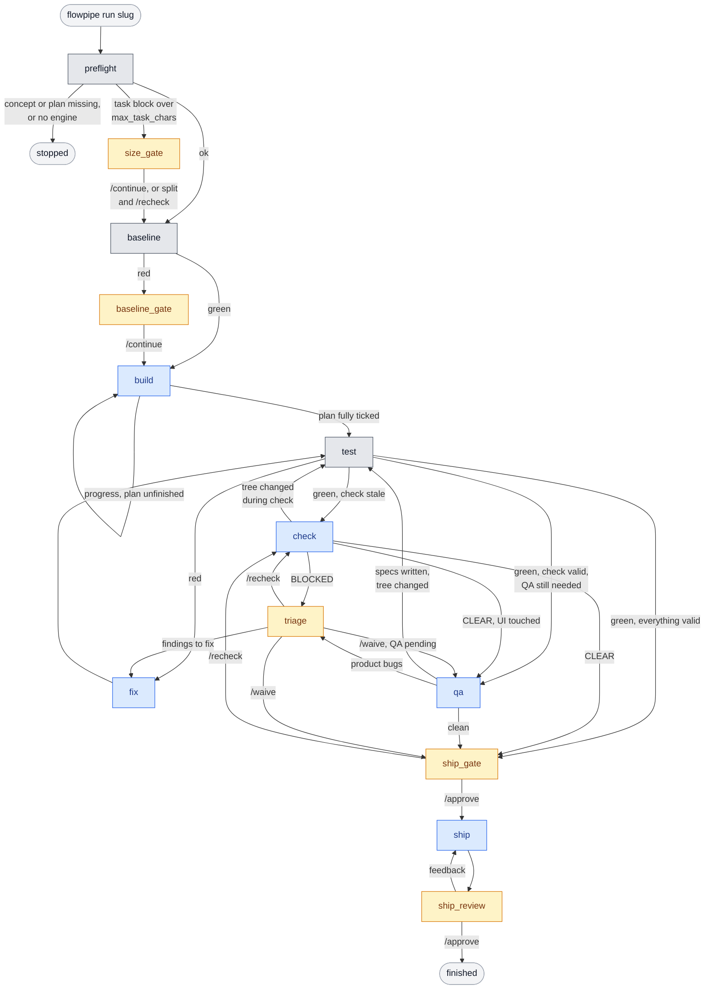
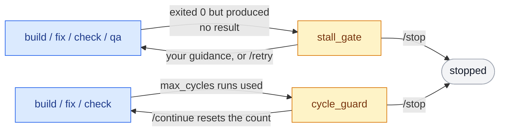

# flowpipe

A LangGraph state machine that runs the [flow](../README.md) pipeline for you,
from an approved plan to ship artifacts. You shape and plan a feature
interactively, then hand over:

    flowpipe run <slug>

flowpipe contains no prompts of its own. Every phase invokes the flow plugin's
own command in a headless agent CLI (Claude Code or opencode), and it decides
what happens next from facts it measures itself: plan checkboxes, the test
suite's exit code, the YAML frontmatter of `check.md` and `qa.md`, and a
fingerprint of the working tree. It never trusts an agent's summary.

## The state machine

Blue nodes run a flow command in the engine, amber nodes wait for you, and grey
nodes are plain code with no model involved. With `triage_policy: auto`,
triage writes the fix list itself and does not wait.

Two safety nets apply to every engine node and are drawn separately to keep
the main graph readable:

Every gate also accepts `/stop`, which ends the run. A run whose plan is
already fully ticked goes from baseline straight to test, and a `/recheck` at
size_gate that still finds oversized tasks asks again.

    preflight    artifacts exist? engine resolves? task blocks within max_task_chars?
    baseline     the one full-suite run before autonomous work
    build        /flow:build, repeated while the plan still has unchecked boxes
    test         your test_command (no LLM); green records the tree fingerprint
    check        /flow:check, verdict read from check.md frontmatter
    qa           /flow:qa, per qa_policy (auto = when check reports ui_touched)
    triage       findings to fix become fixlist.md
    fix          /flow:fix, then always back through test
    ship_gate    YOU: verdict summary, approve to continue
    ship         /flow:ship, then YOU approve the commit message, changelog and
                 MR text, or reply with feedback to regenerate them

flowpipe never commits, pushes or opens a merge request. `/flow:build` and
`/flow:fix` commit per task as the plan specifies; shipping stays yours.

### Where it stops and asks you

| Gate          | When                                                            | Answers |
|---------------|-----------------------------------------------------------------|---------|
| size_gate     | a plan task block exceeds `max_task_chars`                      | `/recheck`, `/continue`, `/stop` |
| baseline_gate | the suite is red before any work started                        | `/continue`, `/stop` |
| stall_gate    | an engine run ended without producing its result                | guidance text, `/retry`, `/stop` |
| triage        | check is BLOCKED or QA found product bugs (`triage_policy: human`) | findings to fix, `/waive`, `/recheck`, `/stop` |
| cycle_guard   | `max_cycles` build/fix/check runs were used                     | `/continue`, `/stop` |
| ship_gate     | everything is green                                             | `/approve`, `/recheck`, `/stop` |
| ship_review   | ship artifacts are ready                                        | `/approve`, or feedback |

**The stall gate** exists because an agent CLI exiting 0 proves nothing. A
session can end by asking a question, after a rejected permission prompt, or by
giving up. flowpipe therefore checks each run for the result it was dispatched
for: build must tick plan boxes, fix must tick fix-list items or change the
tree, check and qa must write a new report. When there is none it shows you the
tail of the engine's output. Whatever you type is passed to the engine as
operator guidance and the phase is re-run, so you can simply answer the
question it asked.

**Backtracking is hash-enforced.** After every green test run the tree is
fingerprinted (sha256 over `git status`, `git diff HEAD`, HEAD and untracked
content, `.work/` excluded). Tests, check and qa are each valid only while the
tree still matches the fingerprint they ran against. A fix, a reviewer touching
a file, or qa writing specs invalidates everything downstream: re-test, then
re-check. A report left behind by an earlier run is never read as the current
one.

## Install

Requires Python 3.10+, git, the flow plugin, and at least one engine CLI.

    pip install -e flowpipe            # from the repo root

Then create the config:

    mkdir -p ~/.config/flowpipe
    cp flowpipe/flow.yaml.example ~/.config/flowpipe/flow.yaml

Set `test_command` to your project's real full suite. For the opencode engine,
render the command files first (`bash scripts/render-opencode.sh`).

Check what a repository resolves to:

    cd ~/projects/my-app
    flowpipe where

## Use

    /flow:shape <idea>          # interactive, in Claude Code or opencode
    /flow:plan <slug>           # interactive, approve the plan
    flowpipe run <slug>         # everything from build to ship artifacts

    flowpipe status [thread]    # pending node, waiting gate, verdicts, cycles
    flowpipe logs [-f]          # engine logs for this repo, optionally follow
    flowpipe resume <thread>    # continue after Ctrl-C, a reboot, or an engine failure
    flowpipe threads            # list runs
    flowpipe run --engine claude <slug>

Every transition is checkpointed to SQLite. Pressing Ctrl-C at a gate detaches;
the run waits for `flowpipe resume`. If an engine crashes or times out,
flowpipe stops with the reason and a resume re-runs exactly the phase that
failed.

Engine output streams live into the terminal, prefixed `[engine:phase]`, and is
written to `<state-dir>/logs/<repo>/<slug>-<phase>-<timestamp>.log`. Set
`FLOWPIPE_QUIET=1` for log-only.

## Config

One global file; nothing goes into your repositories. Resolution, first match
wins: `$FLOW_CONFIG`, a `flow.yaml` in the current directory, the global file.

| Key                 | Default        | Meaning |
|---------------------|----------------|---------|
| `engine`            | auto-detect    | engine for every phase; `FLOW_ENGINE` and `--engine` override |
| `phase_engines`     | none           | per-phase engine, e.g. `{check: claude}` |
| `test_command`      | `pytest -x -q` | the project's full suite |
| `max_cycles`        | 5              | build/fix/check runs before the cycle gate |
| `max_task_chars`    | 8000           | size cap for an unfinished plan task block |
| `qa_policy`         | `auto`         | `auto`, `always`, `never` |
| `triage_policy`     | `human`        | `human`, or `auto` to fix all High findings and product bugs unasked |
| `require_ce_review` | `false`        | `true`: a check that skipped ce-code-review is not CLEAR |

Per-project overrides live in the same file under `projects:`, keyed by repo
path (globs and `~` supported, longest match wins). See `flow.yaml.example`.

With `triage_policy: auto` you are only stopped by the stall gate, the cycle
cap and the two ship gates. A skipped required review, or a report flowpipe
cannot parse, still goes to you: no fix list can resolve those.

### Engines

An engine is a command line plus an invocation style:

- `invoke: slash` - the CLI runs slash commands itself
  (`claude -p "/flow:build <slug>"`). The operator note travels behind
  `extra_flag`, never in the prompt: Claude Code substitutes everything after
  the command name into `$ARGUMENTS`, so an appended note would become part of
  the slug.
- `invoke: template` - flowpipe reads `<commands_dir>/flow-<cmd>.md`, strips the
  frontmatter, substitutes `$ARGUMENTS`, and passes the text as the prompt.

Agent CLIs change their flags; the full command line is in `flow.yaml` so a
renamed flag is a one-line fix.

## Running headless: permissions

A headless engine cannot answer a permission prompt, so anything not
pre-approved is rejected and the phase stalls. flowpipe tells every engine to
stay inside the repository, and the stall gate shows you a rejection when one
happens, but the allow-list is yours to set:

- **opencode**: allow what the phases need in `opencode.json` under
  `permission` (`edit`, `bash`). Writes outside the repo are governed by
  `external_directory`; leave it denied and keep engines inside the repo.
- **Claude Code**: `--permission-mode acceptEdits` approves file edits only.
  Without more, `/flow:build` stalls on its first test run ("This command
  requires approval"). Add the commands your suite and git workflow need via
  `--allowedTools` in the engine's `cmd`, as `flow.yaml.example` shows, or via
  `permissions.allow` in your settings. Use a bypass mode only inside a
  sandbox you trust.

Engines get an empty stdin, so gate answers can be piped into flowpipe
(`printf '/approve\n/approve\n' | flowpipe resume <thread>`) without an engine
swallowing them.

## Limits worth knowing

- If you continue past a red baseline, a later red suite is still sent to
  `/flow:fix`, which may then work on failures that predate the feature.
- Verdicts depend on the model writing the frontmatter. A report without it is
  treated as not CLEAR and sent to triage.
- `triage_policy: auto` hands `/flow:fix` one item per report ("every
  unresolved High finding"), not one item per finding.

## Development

    pip install -e "flowpipe[dev]"
    cd flowpipe && python -m pytest

The tests drive the real CLI against a throwaway git repo with a scripted fake
engine (`tests/fake_engine.py`), so the graph, the checkpointer, the engine
subprocess and every gate are exercised without calling a model.
